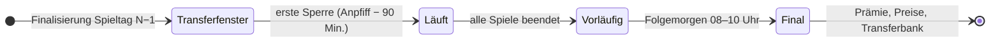
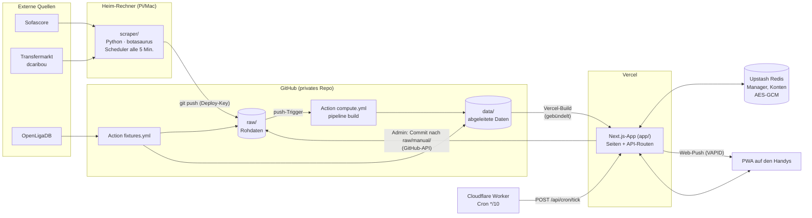
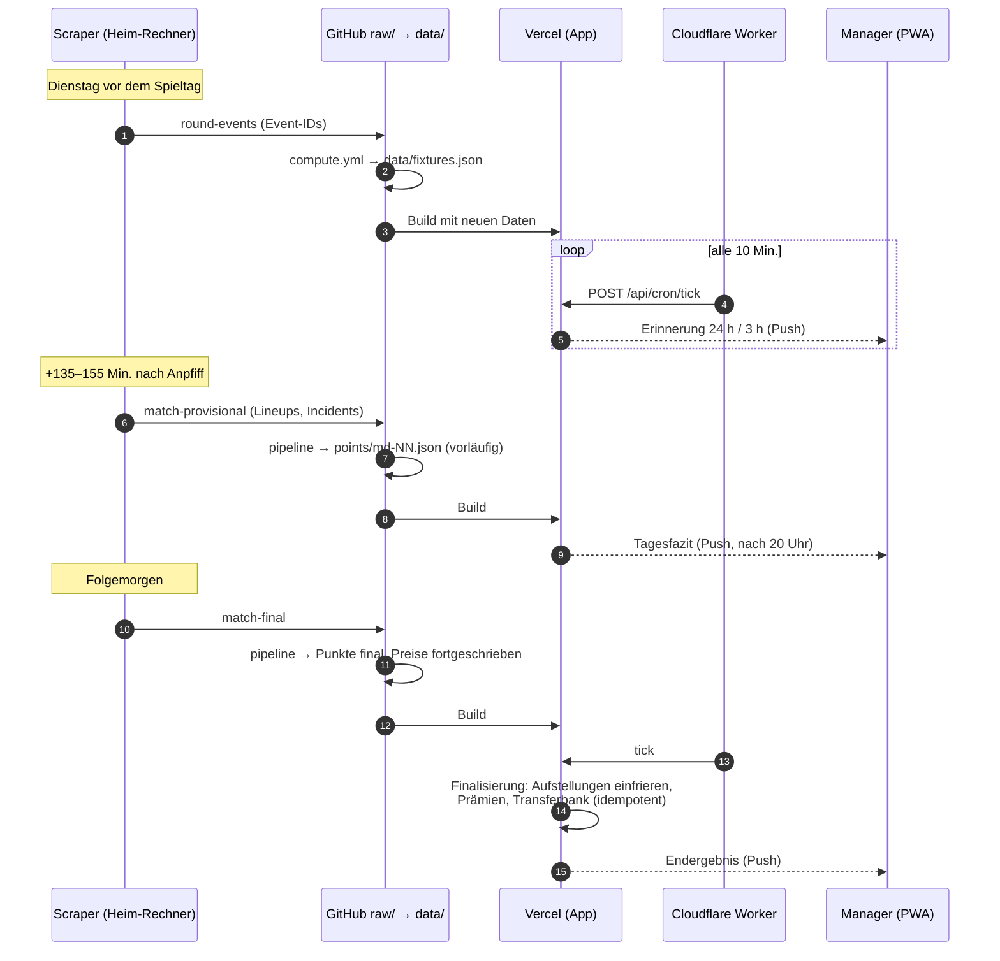

# Flutlicht

Privater Bundesliga-Fantasy-Manager für eine geschlossene Freundesrunde. Jeder
Manager stellt aus allen Spielern der 1. Bundesliga einen Kader zusammen, stellt
Spieltag für Spieltag auf und handelt am Markt. Punkte entstehen datenbasiert aus
Spielernoten und Ereignissen der echten Spiele, die Preise bewegen sich mit der Leistung.

Die App ist eine mobile PWA auf Deutsch mit Push-Benachrichtigungen und läuft
komplett in Gratis-Tarifen: <https://flutlicht.a-tec.dev>.

> Die verbindliche Spezifikation ist [`KONZEPT.md`](KONZEPT.md). Getroffene Annahmen
> und Abweichungen stehen in [`docs/entscheidungen.md`](docs/entscheidungen.md), der
> Projektstand in [`docs/fortschritt.md`](docs/fortschritt.md), der Betrieb in
> [`docs/betrieb.md`](docs/betrieb.md).

---

## Teil 1 · Fachliche Sicht

### Spielidee

| Baustein | Regel (Kurzfassung) |
|---|---|
| **Kader** | Genau 15 Spieler: 2 TW, 5 ABW, 5 MF, 3 ST, höchstens 5 pro Verein. Mehrere Manager dürfen denselben Spieler haben. |
| **Budget** | Gleiches Startbudget für alle, abgeleitet aus dem Median der Stammspieler-Preise. |
| **Aufstellung** | 11 Starter in einer von 7 Formationen, dazu Ersatz-TW und 3 Bankspieler in fester Reihenfolge. Spielt ein Starter 0 Minuten, rückt der erste Bankspieler derselben Position nach. |
| **Kapitän** | Seine Punkte zählen doppelt, auch negative. Kein Vize. |
| **Sperren** | Jeder Spieler ist ab 90 Minuten vor Anpfiff seines Spiels gesperrt. Der Server entscheidet, nie der Client. |
| **Transfers** | Ein Transfer ist ein Tausch auf gleicher Position zum aktuellen Preis. 2 freie Transfers pro Spieltag (1 wird übertragen, max. 3), jeder weitere kostet −5 Punkte. In Pausen ab 10 Tagen und beim Kaderaufbau unbegrenzt. |
| **Punkte** | Sofascore-Note (`(Note − 6,5) × 5`, anteilig bis 60 Min.) plus Ereignisse nach Position (Tore, Vorlagen, zu null, Karten, Elfmeter …) plus +2 für einen echten Startelf-Einsatz. |
| **Preise** | Startpreis aus dem Transfermarkt-Wert (Wurzelskala, 0,5–25 Mio.). Nach jedem finalen Spieltag ±bis zu 8 % je nach Leistung gegenüber der Erwartung (Ø der letzten 5 Einsätze). |
| **Kaufbarkeit** | Aktive Spieler mit Transfermarkt-Zuordnung oder eigenem Admin-Wert. Ohne Zuordnung (meist Nachwuchs) oder ohne Marktwert nicht kaufbar. |
| **Spieltagsprämie** | 0,03 Mio. je Punkt über dem Median der Liga, 0 bis 2 Mio., bei der Finalisierung aufs Guthaben. |
| **Wertung** | Gewertet werden nur Punkte. Gesamttabelle nach Summe, Tie-Break: Spieltagssiege, dann bester Einzelspieltag. Guthaben und Kaderwert werden angezeigt, zählen aber nicht. |

Die exakten Regeln inklusive Rechenbeispielen stehen in `KONZEPT.md` Abschnitt 2–4.
Alle Konstanten liegen zentral in `core/src/config/` (`rules.ts`, `scoring.ts`, `market.ts`).

### Ablauf eines Spieltags



- **Transferfenster:** Kader tauschen, Aufstellung frei ändern. Erinnerungen per Push
  24 h und 3 h vor der ersten Sperre, wenn die Aufstellung Lücken hat.
- **Läuft:** Nur noch Aufstellungsänderungen ungesperrter Spieler. Fremde Aufstellungen
  werden pro Spieler ab dessen Sperre sichtbar.
- **Vorläufig:** Punkte ca. 2,5 Stunden nach Anpfiff, abends ein Tagesfazit per Push.
- **Final:** Aufstellungen werden eingefroren, Prämien gutgeschrieben, Preise
  fortgeschrieben, Endergebnis per Push.

Der erste gewertete Spieltag ist eine Admin-Einstellung. Der Spieltag davor läuft im
**Schattenbetrieb**: Er wird komplett berechnet und angezeigt, aber nicht gewertet.

### Rollen und Seiten

| Seite | Inhalt |
|---|---|
| **Team** | Spielfeld mit Formation, Bank, Kapitän, Sperr-Countdown je Spieler, Punkte des laufenden Spieltags, automatisch aufstellen |
| **Markt** | Alle Spieler mit Suche, Filtern (Position, Verein, Preis) und Sortierung (Preis, Punkte, Form); Erstkader-Aufbau und Tausch mit Live-Regelprüfung |
| **Spieltag** | Punkte-Aufschlüsselung je Spieler, Auto-Wechsel, andere Manager, Median und Prämie |
| **Tabelle** | Reiter **Manager** (Gesamttabelle, Spieltagssieger, Verlauf) und **Bundesliga** (echte Tabelle) |
| **Historie** | Verlauf je Spieltag (Transfers, Punkte, Kaderwert-Änderung, Prämie) sowie Gewinn und Verlust je Spieler |
| **Spielerprofil** | Preisverlauf, Punkte je Spieltag, Erklärung der Preisbildung |
| **Optionen** | Push-Einstellungen, Test-Push, Version, Abmelden |
| **Admin** | Einladungscodes, Manager, Saisonstart und Startbudget, Transfermarkt-Zuordnung, fehlende Werte, Positionen, Spielnachtrag, Neuberechnung, Status |

Registrierung nur mit Einladungscode. Die Admin-Rolle vergibt `ADMIN_EMAILS`.

---

## Teil 2 · Technische Architektur

### Überblick



**Grundprinzip:** Git enthält die Fußballwelt (öffentliche Fakten, reproduzierbar aus
`raw/`). Redis enthält die Manager (Konten, Kader, Aufstellungen, Transfers). Die App
verbindet beides zur Laufzeit. Die Pipeline kennt keine Nutzerdaten, die App schreibt
nie nach `data/`.

### Komponenten

| Paket | Technik | Aufgabe |
|---|---|---|
| **`core/`** | TypeScript, zod 4, keine I/O | Einzige Quelle für Regeln, Punkte, Preise, Formationen, Sperren, Transfers, Wertung, Tick-Planung. Reine Funktionen, von App und Pipeline importiert (`@fm/core`). |
| **`pipeline/`** | TypeScript (GitHub Actions) | Deterministischer, idempotenter Build `raw/` → `data/`: Vereine, Spieler und Startpreise, Spielplan, Punkte je Spieltag, Preisverlauf, Saison, Review-Listen. zod-Validierung und Sanity-Guard vor dem Schreiben. |
| **`app/`** | Next.js 15 (App Router), React 19, Tailwind, NextAuth 5 | PWA mit Server-Components und API-Routen. Lädt `data/` gebündelt beim Build, Nutzerdaten aus Redis. Rechnet nie selbst, ruft immer `core` auf. |
| **`scraper/`** | Python ≥ 3.11, botasaurus, Pillow | Läuft auf dem Heim-Rechner. Holt Sofascore-Spieldaten, Kader, Bilder sowie Transfermarkt-Werte und pusht sie nach `raw/`. |
| **`infra/cron-worker/`** | Cloudflare Worker | Taktgeber alle 10 Minuten für `/api/cron/tick`, weil Vercel Hobby nur tägliche Crons erlaubt. |
| **`.github/workflows/`** | GitHub Actions | `ci.yml` (Lint, Typecheck, Tests), `e2e.yml` (Playwright, nur bei App-Änderungen), `scraper.yml` (pytest, nur bei Scraper-Änderungen), `compute.yml` (Pipeline bei `raw/`-Änderungen, manuell oder per Admin), `fixtures.yml` (OpenLigaDB-Spielplan + Pipeline), `_alert.yml` (Issue bei Fehlschlag). |

### Datenfluss eines Spieltags



### Datenhaltung

| Ort | Wer schreibt | Inhalt |
|---|---|---|
| `raw/sofascore/`, `raw/transfermarkt/`, `raw/dcaribou/` | nur der Scraper | Rohes JSON unverändert, mit Hülle `{ fetchedAt, url, phase }` |
| `raw/openligadb/` | Action `fixtures.yml` | Spielplan, Anstoßzeiten, Ergebnisse |
| `raw/manual/` | Admin über die GitHub-API | Zuordnungen, Marktwerte, Positionen, Saisonstart, Spielnachträge |
| `data/` | nur die Pipeline | `teams`, `players`, `fixtures`, `points/md-NN`, `market/history`, `season`, `meta`, `review/*` |
| `app/public/img/` | Scraper | Vereinslogos und Spielerbilder als 128-px-WebP |
| Upstash Redis | App | Manager-Dokumente, Liga (Einladungen), Push-Anmeldungen, Tick-Zustand. Jedes Dokument mit AES-GCM verschlüsselt, optimistische Sperre über `updatedAt`. |

Punkte-Priorität je Spiel: Admin-Nachtrag vor Sofascore-final vor Sofascore-vorläufig.
Jeder Pipeline-Lauf rechnet alles neu, deshalb ist jeder Stand aus `raw/` reproduzierbar.

### Sicherheit

- **Anmeldung:** NextAuth mit E-Mail und Passwort (scrypt), Registrierung nur mit
  Einladungscode, Rate-Limits über Upstash.
- **API-Guard:** Jede Route nutzt `withUser` oder `withAdmin`. Öffentliche Ausnahmen
  stehen begründet in `app/lib/public-api-paths.ts`, ein Test erzwingt das.
  Die Admin-Rolle wird bei jedem Aufruf aus dem Manager-Dokument gelesen.
- **Tick:** `/api/cron/tick` nur mit `Authorization: Bearer $CRON_SECRET`.
- **Daten:** Kein öffentliches `/data/`. Der Client bekommt Spieldaten nur über
  Server-Components und API-Routen, fremde Aufstellungen erst ab Sperre.
- **Secrets:** nur in Vercel, Cloudflare und auf dem Heim-Rechner, nie im Repo (`.env*` ist gitignored).

### Scraping-Regeln (nicht verhandelbar)

Keine Parallelität, 8–20 s Abstand zwischen Abrufen, nachts keine Abrufe, nur die
festgelegten Endpunkte. Erst `request`-Modus, bei 403 oder Bot-Challenge der
Browser-Modus. Bei 429 oder wiederholtem 403 Abbruch und 6 h Pause. Alle HTTP-Aufrufe
laufen über `scraper/fm_scraper/client.py`. Tests machen keine echten Abrufe.
Details: `KONZEPT.md` 5.5–5.6.

### Qualität

- `pnpm lint && pnpm typecheck && pnpm test` muss grün sein, die CI prüft zusätzlich Prettier.
- `core` hat eine Coverage-Pflicht von 95 %. Die Rechenbeispiele aus `KONZEPT.md` 3.5 und 4.x
  sind wörtlich als Tests übernommen.
- Playwright-E2E-Tests (mobil) für Registrierung, Erstkader, Seiten und Admin;
  `pytest` für Scraper, Scheduler (feste Uhr) und Client.

---

## Repo-Layout

```
flutlicht/
├─ app/                 Next.js-App (Vercel Root Directory)
├─ core/                Regeln, Punkte, Preise, Schemas (reine Funktionen)
├─ pipeline/            raw/ → data/ (GitHub Actions)
├─ scraper/             Heim-Rechner: Sofascore, Transfermarkt, Bilder → raw/
├─ infra/cron-worker/   Cloudflare Worker (Taktgeber)
├─ raw/                 Rohdaten (committet)
├─ data/                abgeleitete Daten (committet, nur Pipeline)
├─ docs/                Entscheidungen, Fortschritt, Betrieb, Sofascore-Felder
├─ scripts/             stage-data (data/ → app/generated), gen-version
└─ .github/workflows/   ci, compute, fixtures, _alert
```

## Lokale Entwicklung

Voraussetzungen: Node ≥ 22.12, pnpm, für den Scraper Python ≥ 3.11.

```bash
pnpm install
pnpm dev                          # App lokal; ohne Redis-Konfiguration Dateispeicher in app/.data/
pnpm lint && pnpm typecheck && pnpm test
pnpm --filter @fm/app test:e2e    # Playwright
pnpm --filter @fm/pipeline build  # data/ lokal aus raw/ neu rechnen (nicht committen)

cd scraper && python3 -m venv .venv && .venv/bin/pip install -e '.[dev]'
.venv/bin/python -m pytest -q
.venv/bin/python -m fm_scraper run <job> [--matchday N] [--event ID] [--no-sync]
```

## Betrieb

| Dienst | Zweck | Konfiguration |
|---|---|---|
| Vercel (Hobby) | App, Domain `flutlicht.a-tec.dev` | `AUTH_SECRET`, `APP_ENCRYPTION_SECRET`, `KV_REST_API_URL`/`KV_REST_API_TOKEN` (Upstash), `VAPID_*`, `NEXT_PUBLIC_VAPID_PUBLIC_KEY`, `CRON_SECRET`, `SCRAPER_SECRET`, `ADMIN_EMAILS`, `GITHUB_PAT`, `GITHUB_REPO` |
| Upstash Redis (Free) | Nutzerdaten, Rate-Limits | über die Vercel-Integration |
| Cloudflare Workers (Free) | Taktgeber `flutlicht-cron` | Secret `CRON_SECRET` (gleicher Wert wie in Vercel), `APP_URL` in `wrangler.jsonc` |
| GitHub Actions | CI, Pipeline, Spielplan | `GITHUB_TOKEN`; der Scraper pusht per Deploy-Key |
| Heim-Rechner | Scraper per systemd-Timer bzw. launchd | siehe [`scraper/README.md`](scraper/README.md) |

`GITHUB_PAT` ist ein fine-grained Token nur für dieses Repo mit **Contents** und
**Actions** jeweils Read and write. Laufende Kosten: 0 € plus Strom für den Heim-Rechner.

Datenquellen: [OpenLigaDB](https://www.openligadb.de) (ODbL), Sofascore, Transfermarkt,
[dcaribou/transfermarkt-datasets](https://github.com/dcaribou/transfermarkt-datasets).
Private, nicht-kommerzielle Nutzung in einer geschlossenen Runde.
